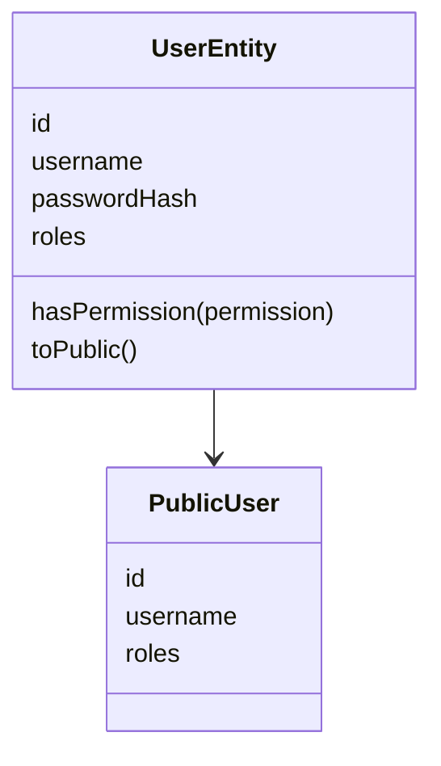
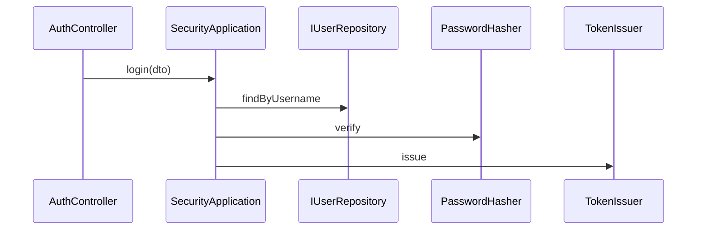

# 安全模块

## 目录

- [模块目录结构](#模块目录结构)
- [功能定义](#功能定义)
- [核心业务层](#核心业务层)
  - [AuthController](#authcontroller)
  - [JwtAuthGuard](#jwtauthguard)
- [核心模型](#核心模型)
- [核心业务](#核心业务)
  - [登录](#登录)
  - [鉴权](#鉴权)

## 模块目录结构

```text
src/features/security/
├── application/
│   └── security_application.ts
├── domain/
│   ├── entities/
│   │   └── user_entity.ts
│   ├── repositories/
│   │   └── i_user_repository.ts
│   ├── password_hasher.ts
│   └── token_issuer.ts
├── infra/
│   ├── bcrypt_password_hasher.ts
│   ├── jwt_auth_guard.ts
│   ├── jwt_token_issuer.ts
│   └── persistence/
│       └── prisma_user_repository.ts
├── presentation/
│   ├── auth_controller.ts
│   └── dto/
│       ├── login_dto.ts
│       └── register_dto.ts
└── security_module.ts
```

`security_module.ts` 把 `IUserRepository`、`PasswordHasher`、`TokenIssuer` 绑到 Prisma、bcrypt 和 JWT 实现，并把 `JwtAuthGuard` 注册为全局守卫。

## 功能定义

安全模块提供身份用例，并校验后续请求的访问凭证。

- `register(input)`：校验用户名、密码和确认密码，保存一个角色为 `user` 的用户。
- `login(input)`：核对口令，签发访问凭证，返回 `{ token, user }`。
- `me(actor)`：按 `Actor.id` 读取当前用户的公开资料。

这些方法在 `SecurityApplication`。用户名去掉首尾空白后不少于 3 个字符，密码不少于 6 个字符，注册时两次密码相同。用户名已存在时返回 409。登录失败返回 401，消息是「用户名或密码错误」。

## 核心业务层

### AuthController

身份接口。文件：`src/features/security/presentation/auth_controller.ts`。路由前缀是 `auth`。

| 方法                                        | 说明                                             |
| ------------------------------------------- | ------------------------------------------------ |
| `register(dto: RegisterDto): Promise<void>` | `POST /auth/register`。公开。HTTP 状态固定为 200 |
| `login(dto: LoginDto)`                      | `POST /auth/login`。公开。HTTP 状态固定为 200    |
| `me(actor: Actor)`                          | `GET /auth/me`。需要凭证                         |

`LoginDto` 要求 `username`、`password`。`RegisterDto` 再增加 `confirmPassword`。用户名在 DTO 里去掉首尾空白。两次密码是否相同由用例判断。

### JwtAuthGuard

全局守卫。文件：`src/features/security/infra/jwt_auth_guard.ts`。

| 方法                                     | 说明                                                                                 |
| ---------------------------------------- | ------------------------------------------------------------------------------------ |
| `canActivate(context): Promise<boolean>` | 公开路由直接放行。否则校验 `Authorization: Bearer`，并把 `Actor` 写到 `request.user` |

凭证缺失、签名无效或用户已不存在时抛出 `DomainError(401)`。

## 核心模型

| 类型              | 文件                                                             | 定义                                                 |
| ----------------- | ---------------------------------------------------------------- | ---------------------------------------------------- |
| `UserEntity`      | `src/features/security/domain/entities/user_entity.ts`           | 用户。持有 `id`、`username`、`passwordHash`、`roles` |
| `PublicUser`      | 同上                                                             | 对外的用户。只有 `id`、`username`、`roles`           |
| `IUserRepository` | `src/features/security/domain/repositories/i_user_repository.ts` | `findByUsername`、`findById`、`save`                 |
| `PasswordHasher`  | `src/features/security/domain/password_hasher.ts`                | `hash`、`verify`                                     |
| `TokenIssuer`     | `src/features/security/domain/token_issuer.ts`                   | `issue(user)` 返回访问凭证                           |



`toPublic` 去掉 `passwordHash`。`hasPermission` 与 `Actor.hasPermission` 使用同一规则：角色含 `admin` 或含指定权限。

登录成功的结果是 `LoginResult`：`token` 和 `user`。它定义在 `security_application.ts`，不是实体文件。

## 核心业务

### 登录



`AuthController.login` 把 `LoginDto` 交给 `login`。用例按去掉空白后的用户名查找用户，再用 `PasswordHasher.verify` 核对口令。用户不存在或口令不对时抛出 401。通过对后，`TokenIssuer.issue` 签发凭证，`UserEntity.toPublic` 形成 `user`。

`JwtTokenIssuer` 把 `sub`、`username`、`roles` 写入凭证。`sub` 是用户 `id`。

`register` 使用同一组端口：先 `findByUsername`，再 `PasswordHasher.hash`，最后 `IUserRepository.save`。`me` 用 `findById`。用户已经不存在时抛出 401，消息是「登录已失效」。

### 鉴权

```mermaid
sequenceDiagram
  participant JwtAuthGuard
  participant IUserRepository
  participant Actor

  JwtAuthGuard->>JwtAuthGuard: canActivate
  JwtAuthGuard->>IUserRepository: findById
  JwtAuthGuard->>Actor: request.user
```

路由标了 `@Public()` 时，`canActivate` 返回真，不读取凭证。其余路由要求 `Authorization` 以 `Bearer ` 开头。校验签名后用 `payload.sub` 调用 `findById`。用户存在时，用其 `id`、`username`、`roles` 构造 `Actor` 并写入 `request.user`。

控制器再用 [认证](<../../基础应用/认证(auth).md>) 的 `CurrentUser` 取出这个 `Actor`。
