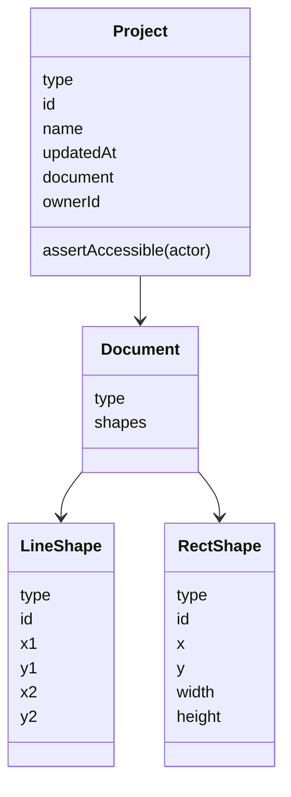
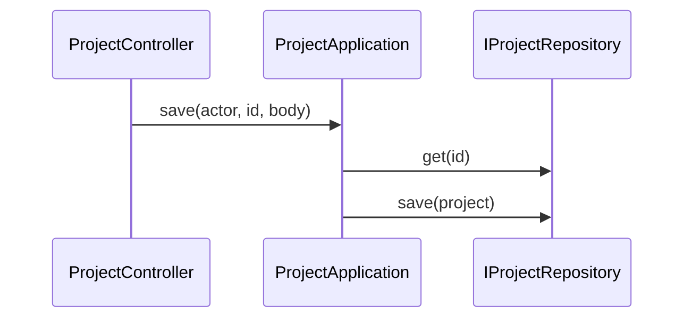

# 项目模块

## 目录

- [模块目录结构](#模块目录结构)
- [功能定义](#功能定义)
- [核心业务层](#核心业务层)
  - [ProjectController](#projectcontroller)
- [核心模型](#核心模型)
- [核心业务](#核心业务)
  - [保存项目](#保存项目)

## 模块目录结构

```text
src/features/project/
├── application/
│   └── project_application.ts
├── domain/
│   ├── entities/
│   │   ├── document.ts
│   │   └── project_entity.ts
│   └── repositories/
│       └── i_project_repository.ts
├── infra/
│   └── persistence/
│       └── prisma_project_repository.ts
├── presentation/
│   └── project_controller.ts
└── project_module.ts
```

`project_module.ts` 把 `IProjectRepository` 绑到 `PrismaProjectRepository`。

## 功能定义

项目模块按调用者维护 `Project` 聚合。

- `list(actor)`：列出 `ownerId` 等于 `actor.id` 的项目，按 `updatedAt` 从新到旧。
- `get(actor, id)`：读取一个项目。不存在，或调用者不能访问时，返回 404。
- `save(actor, id, raw)`：校验报文并保存整个聚合。新建时 `ownerId` 取 `actor.id`；已存在时沿用原来的 `ownerId`。

这些方法在 `ProjectApplication`。返回值都经过 `plainProject`，因此响应里没有 `ownerId`。

撤销和重做留在前端聚合里。本模块保存的是文档本身。

## 核心业务层

### ProjectController

项目接口。文件：`src/features/project/presentation/project_controller.ts`。路由前缀是 `projects`。三个方法都需要凭证。

| 方法                    | 说明                                                          |
| ----------------------- | ------------------------------------------------------------- |
| `list(actor)`           | `GET /projects`                                               |
| `get(actor, id)`        | `GET /projects/:id`                                           |
| `save(actor, id, body)` | `PUT /projects/:id`。`body` 是未知 JSON，由用例收成 `Project` |

## 核心模型

`Project` 是聚合根。文件：`src/features/project/domain/entities/project_entity.ts`。

| 类型                 | 文件                                                               | 定义                                                                  |
| -------------------- | ------------------------------------------------------------------ | --------------------------------------------------------------------- |
| `Project`            | `src/features/project/domain/entities/project_entity.ts`           | 聚合根。持有 `type`、`id`、`name`、`updatedAt`、`document`、`ownerId` |
| `Document`           | `src/features/project/domain/entities/document.ts`                 | 图形文档。持有 `type` 和 `shapes`                                     |
| `LineShape`          | 同上                                                               | 一条线段。`type` 为 `project/LineShape`                               |
| `RectShape`          | 同上                                                               | 一个矩形。`type` 为 `project/RectShape`                               |
| `IProjectRepository` | `src/features/project/domain/repositories/i_project_repository.ts` | `list(ownerId)`、`get(id)`、`save(project)`                           |



`type` 是报文上的判别字段。`Project` 固定为 `project/Project`，`Document` 固定为 `project/Document`。`shapes` 按每项的 `type` 建成 `LineShape` 或 `RectShape`。

`ownerId` 只存在于服务端。`plainProject` 使用 `instanceToPlain`，`@Exclude({ toPlainOnly: true })` 使它不进入响应。

`assertAccessible` 在 `ownerId` 等于 `actor.id`，或 `actor.hasPermission('project:write')` 时通过。否则抛出 `DomainError(404)`，消息是「项目不存在」。

`projectFromClient` 收前端报文。报文不是对象，或报文里的字符串 `id` 与路径 `id` 不同，则 400。缺少 `document` 时使用 `{ type: 'project/Document', shapes: [] }`。名称会去掉首尾空白，空白名称返回「项目名称不能为空」。校验通过后写入调用者决定的 `ownerId`。

`projectFromRecord` 把数据库行收成 `Project`。行内文档若只有 `$modelType`、没有 `type`，先抄成 `type`。以 `$` 开头的字段不进入实体。

## 核心业务

### 保存项目



`ProjectController.save` 把路径 `id`、报文和 `Actor` 交给 `save`。用例先 `get`。已有项目时调用 `assertAccessible`，不能访问则不再写入。`projectFromClient` 收成 `Project` 后调用 `IProjectRepository.save`，再以 `plainProject` 返回。

`PrismaProjectRepository.save` 按 `id` 做 `upsert`。`document` 列保存 `instanceToPlain(project.document)` 的 JSON。`list` 和 `get` 用 `projectFromRecord` 读回。

`list` 只查询当前 `actor.id` 拥有的项目。`get` 按 id 读取后调用 `assertAccessible`。
