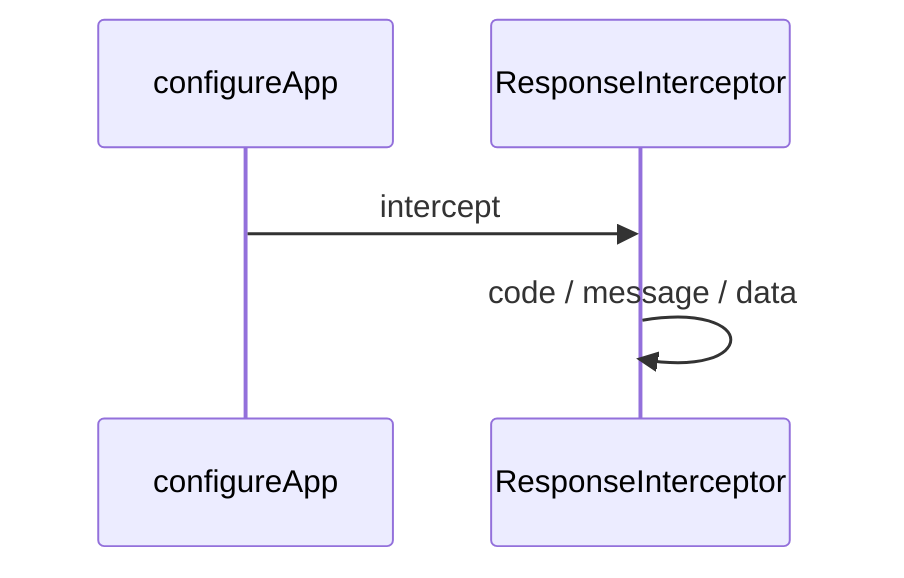

# HTTP

## 目录

- [功能定义](#功能定义)
- [使用示例](#使用示例)
- [时序](#时序)
  - [成功响应](#成功响应)

## 功能定义

HTTP 把 Nest 应用收成前端认得的响应：成功是 `{ code: 200, message, data }`，失败是 `{ code: status, message, data: null }`，HTTP 状态与 `code` 相同。

| 入口                  | 文件                                    | 定义                                                                       |
| --------------------- | --------------------------------------- | -------------------------------------------------------------------------- |
| `configureApp(app)`   | `src/app/http/configure_app.ts`         | 打开 CORS，挂上校验和响应拦截器                                            |
| `ResponseInterceptor` | `src/app/http/response_interceptor.ts`  | 把控制器的返回值包进 `code`、`message`、`data`                             |
| `AllExceptionsFilter` | `src/app/http/all_exceptions_filter.ts` | 把 `DomainError` 和 `HttpException` 写成同一形状。其余异常记日志并返回 500 |

`configureApp` 的 `ValidationPipe` 使用 `whitelist` 和 `transform`。没有写在 DTO 上的字段会被去掉。不开启 `forbidNonWhitelisted`，因此登录报文里多出来的字段不会变成 400。

CORS 读取 `CORS_ORIGIN`。多个来源用逗号分隔。

`ResponseInterceptor` 若发现返回值已经带有数字 `code` 和 `data`，就原样送出。成功报文里的 `message: 'ok'` 保持原文。

`AllExceptionsFilter` 由 `AppModule` 以 `APP_FILTER` 注册。它按请求的 `Accept-Language` 把消息键译成句子，见 [国际化](<./国际化(i18n).md>)。

## 使用示例

`main.ts` 在监听之前调用一次：

```ts
const app = await NestFactory.create(AppModule, {
  instrument: ObserveInstrument,
});
configureApp(app);
```

用例抛出的 `DomainError` 不在控制器里捕获。文件：`src/features/security/application/security_application.ts`。

```ts
if (!user || !matched) {
  throw new DomainError(401, 'security.err_invalid_credentials');
}
```

没有 `Accept-Language` 时，过滤器把它写成 `{ code: 401, message: '用户名或密码错误', data: null }`。

## 时序

### 成功响应



控制器返回业务数据后，`ResponseInterceptor` 包成 `{ code: 200, message: 'ok', data }`。`data` 为空时写成 `null`。

异常不走这条成功路径。`DomainError` 使用它自己的 `status`，`message` 按本次请求翻译。`HttpException` 使用它的状态码；校验失败的多条消息用 `'; '` 接成一条，再逐段翻译。其他异常返回 `{ code: 500, message: '服务器错误', data: null }`。默认语言是中文。
