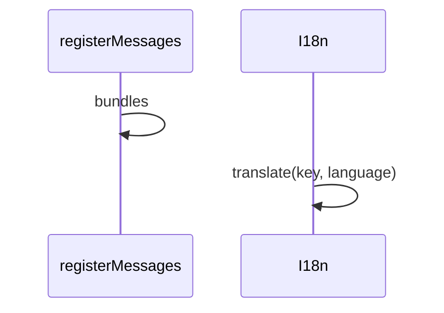

# 国际化

## 目录

- [功能定义](#功能定义)
- [使用示例](#使用示例)
- [时序](#时序)
  - [取出文案](#取出文案)

## 功能定义

国际化保存各模块的文案，并按本次请求的语言取出文本。默认语言是 `zh`。请求头 `Accept-Language` 的第一段以 `en` 开头时使用 `en`。

| 入口                                       | 文件                      | 定义                                     |
| ------------------------------------------ | ------------------------- | ---------------------------------------- |
| `registerMessages(feature, locales)`       | `src/app/i18n/catalog.ts` | 把一个功能模块的 `zh`、`en` 文案写入目录 |
| `buildResources()`                         | 同上                      | 把已登记的文案交给 i18next               |
| `resolveLanguage(header)`                  | `src/app/i18n/i18n.ts`    | 从 `Accept-Language` 得到 `zh` 或 `en`   |
| `I18n.translate(key, language)`            | 同上                      | 按键和语言取出文本                       |
| `I18n.translateMessage(message, language)` | 同上                      | 把以 `'; '` 分开的多个键分别翻译         |

功能模块自己的键缺失时，会改查 `common` 下的同名键。

## 使用示例

安全模块在加载时登记文案。文件：`src/features/security/i18n/index.ts`。

```ts
registerMessages('security', { zh: zhCN, en: enUS });
```

`security_module.ts` 顶部导入这个文件，登记才会执行。项目模块同样导入 `./i18n/index.js`。

异常过滤器把消息键翻成句子。文件：`src/app/http/all_exceptions_filter.ts`。

```ts
this.i18n.translateMessage(exception.message, language);
```

用例抛出的是键，例如 `security.err_invalid_credentials`。没有 `Accept-Language` 时，响应里的消息是「用户名或密码错误」。

## 时序

### 取出文案



功能模块文件加载时，`registerMessages` 先写入 `bundles`。`I18n` 第一次使用时用这些文案初始化。此后按传入的 `language` 取出文本。尚未登记的键保持原样；同一模块下缺失的键会再查 `common`。
