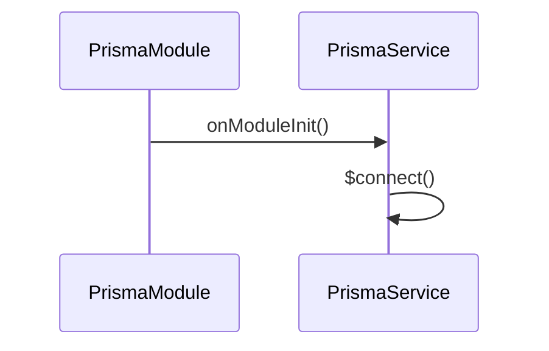

# 数据库

## 目录

- [功能定义](#功能定义)
- [使用示例](#使用示例)
- [时序](#时序)
  - [连接](#连接)

## 功能定义

数据库用 Prisma 7 连接 SQLite，并向功能模块提供同一个 `PrismaService`。

| 入口            | 文件                               | 定义                                                               |
| --------------- | ---------------------------------- | ------------------------------------------------------------------ |
| `PrismaModule`  | `src/app/prisma/prisma_module.ts`  | 提供并导出 `PrismaService`                                         |
| `PrismaService` | `src/app/prisma/prisma_service.ts` | 继承生成的 `PrismaClient`。启动时 `$connect`，关闭时 `$disconnect` |
| `schema.prisma` | `prisma/schema.prisma`             | 声明 `User` 和 `Project`。客户端生成到 `src/generated/prisma`      |

连接地址来自 `DATABASE_URL`。适配器是 `PrismaBetterSqlite3`。迁移文件在 `prisma/migrations`。`npm run start:dev` 和 `npm run build` 会先执行 `prisma generate`。

`User.roles` 和 `Project.document` 在库里都是字符串。仓储负责把它们收成领域对象。

## 使用示例

项目仓储通过注入的 `PrismaService` 读写。文件：`src/features/project/infra/persistence/prisma_project_repository.ts`。

```ts
const record = await this.prisma.project.findUnique({ where: { id } });
```

功能模块的 `Module` 需要 `imports: [PrismaModule]`，仓储才能拿到 `PrismaService`。

## 时序

### 连接



应用启动时 Nest 调用 `onModuleInit`，`PrismaService` 连接 `DATABASE_URL`。进程退出时 `onModuleDestroy` 调用 `$disconnect`。仓储在连接建立之后使用 `this.prisma` 上的 `user` 和 `project`。
