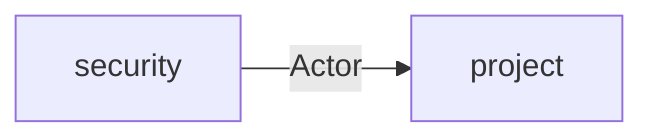

# 项目架构

## 目录

- [项目目录结构](#项目目录结构)
- [模块定义](#模块定义)
  - [基础应用](#基础应用)
  - [功能模块](#功能模块)
- [模块间数据流](#模块间数据流)
  - [身份与项目](#身份与项目)

## 项目目录结构

本仓库是 `bq_react` 的后端。分层和文档分类与前端一致。前端有页面和本地库，后端用 HTTP 入口和 Prisma 替换它们。

```text
src/
├── app/
│   ├── auth/
│   ├── domain/
│   ├── http/
│   ├── i18n/
│   └── prisma/
├── features/
│   ├── project/
│   └── security/
├── app_controller.ts
├── app_module.ts
└── main.ts
```

`main.ts` 创建应用并调用 `configureApp`。`AppModule` 引入 `PrismaModule`、`I18nModule`、`SecurityModule`、`ProjectModule`。`AppController` 提供 `GET /health`，不是功能模块。`src/generated` 由 Prisma 生成，不在这棵树里。

## 模块定义

`src/app` 下每个目录是一个基础应用，供功能模块使用。`src/features` 下每个目录是一个功能模块，承载一块业务。功能模块的定义写它的 application 用例。

### 基础应用

| 模块                                         | 目录             | 定义                                                   |
| -------------------------------------------- | ---------------- | ------------------------------------------------------ |
| [认证入口](<./基础应用/认证(auth).md>)       | `src/app/auth`   | 标记公开路由，并从请求上取出 `Actor`                   |
| [领域公共类型](<./基础应用/领域(domain).md>) | `src/app/domain` | 提供当前调用者 `Actor`，以及带状态码的 `DomainError`   |
| [HTTP](<./基础应用/HTTP(http).md>)           | `src/app/http`   | 校验入参，把成功和失败都收成 `{ code, message, data }` |
| [国际化](<./基础应用/国际化(i18n).md>)       | `src/app/i18n`   | 登记文案，并按请求的 `Accept-Language` 取出文本        |
| [数据库](<./基础应用/数据库(prisma).md>)     | `src/app/prisma` | 连接 SQLite，并向功能模块提供 `PrismaService`          |

### 功能模块

| 模块                                                | 目录                    | 定义                                                   |
| --------------------------------------------------- | ----------------------- | ------------------------------------------------------ |
| [项目](<./功能模块/项目模块/项目模块(project).md>)  | `src/features/project`  | 按调用者列出、读取、保存项目聚合                       |
| [安全](<./功能模块/安全模块/安全模块(security).md>) | `src/features/security` | 提供身份用例：注册、登录、读取当前用户，并校验访问凭证 |

## 模块间数据流

### 身份与项目



`security` 在登录时签发访问凭证。之后每次进入 `project` 的 `list`、`get`、`save`，都带上这个凭证对应的 `Actor`。`project` 用 `Actor.id` 决定项目归属，用 `Actor.hasPermission` 决定能否打开他人的项目。未通过校验时，`Actor` 不会进入 `project`。
